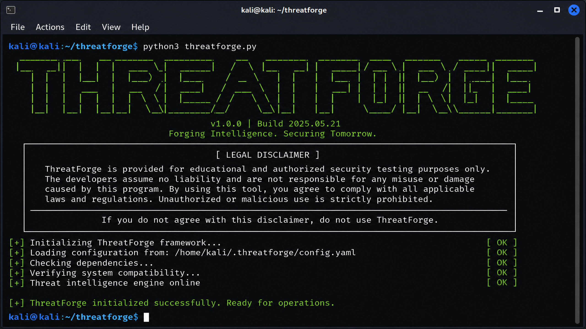
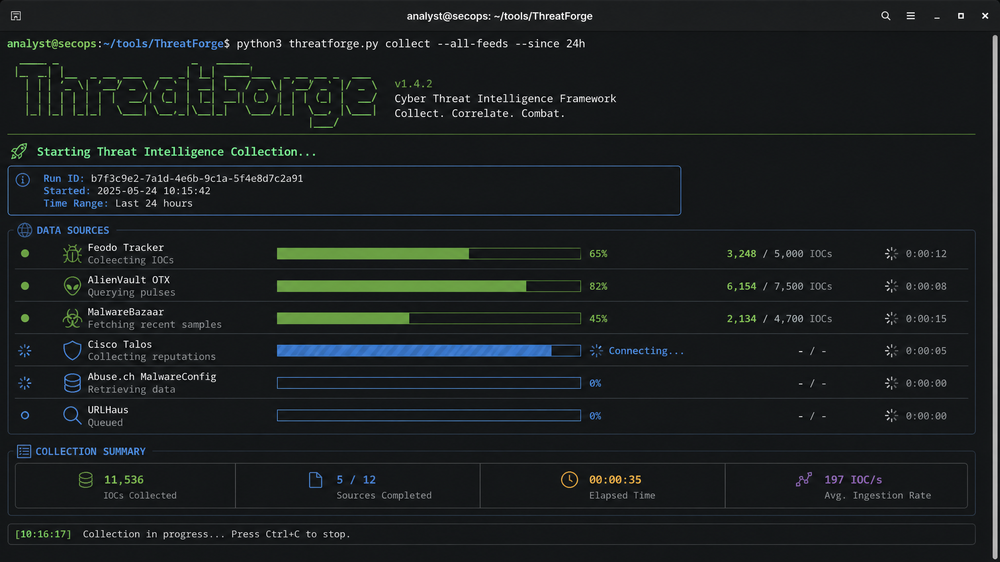
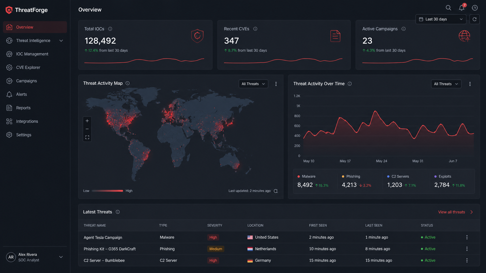
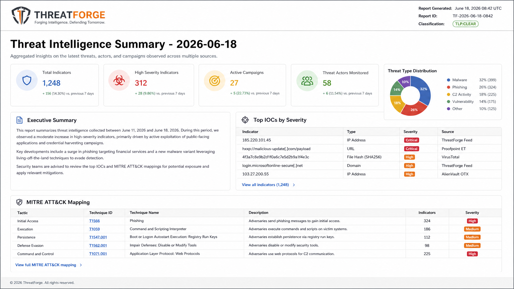
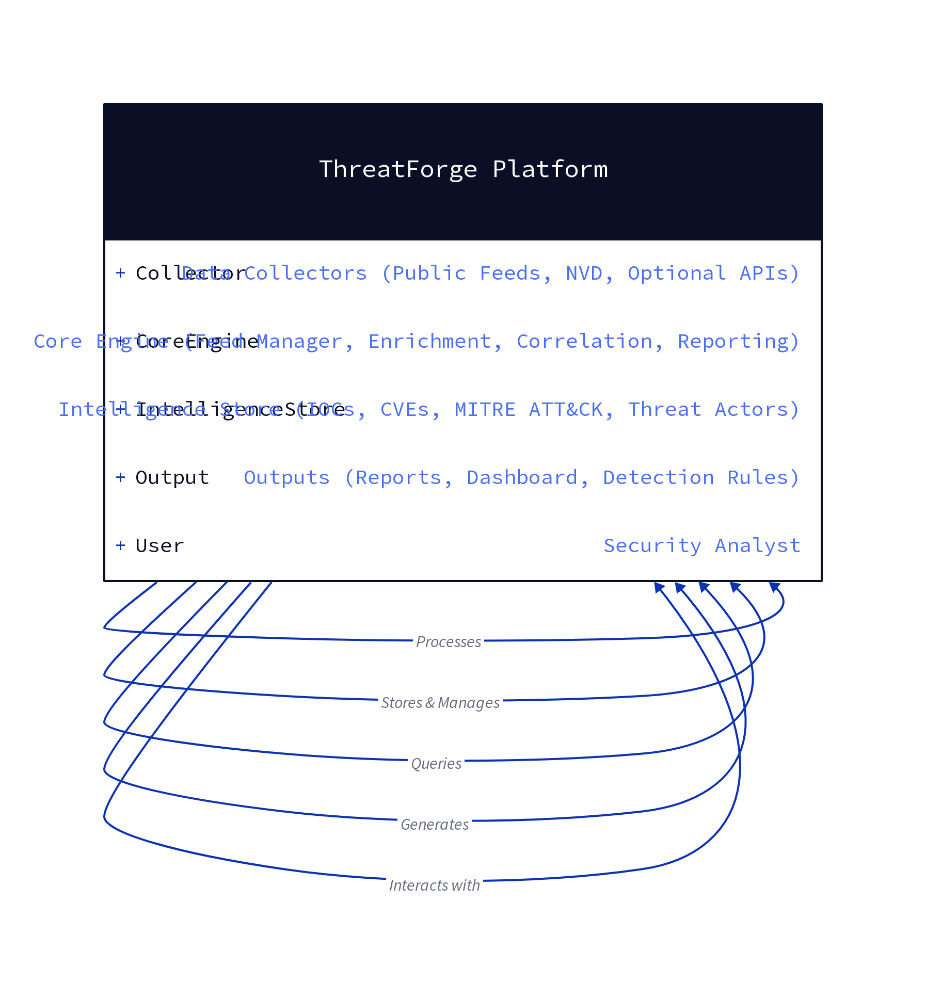

# ThreatForge

```text
  _____ _   _ ____  _____    _  _____ _____ ___  ____   ____ _____ 
 |_   _| | | |  _ \| ____|  / \|_   _|  ___/ _ \|  _ \ / ___| ____|
   | | | |_| | |_) |  _|   / _ \ | | | |_ | | | | |_) | |  _|  _|  
   | | |  _  |  _ <| |___ / ___ \| | |  _|| |_| |  _ <| |_| | |___ 
   |_| |_| |_|_| \_\_____/_/   \_\_| |_|   \___/|_| \_\\____|_____|
```

**Cyber Threat Intelligence & IOC Correlation Platform**

   

## ⚠️ LEGAL DISCLAIMER ⚠️
ThreatForge is a threat intelligence platform designed for **EDUCATIONAL PURPOSES and AUTHORIZED SECURITY USE ONLY**.

By using this software, you agree to:
- ONLY use threat intelligence data for legitimate security purposes
- Comply with all applicable laws and regulations
- Respect the terms of service of all data sources
- Accept full responsibility for your actions
- NOT use this tool for illegal or unauthorized activities

The authors assume NO LIABILITY for misuse, damage, or legal consequences resulting from the use of this software.

**USE RESPONSIBLY. STAY LEGAL. BE ETHICAL.**

## Quick Start
```bash
git clone https://github.com/yourusername/threatforge.git
cd threatforge
pip install -r requirements.txt

# Run full pipeline
python threatforge.py --mode full --format all

# Run specific mode
python threatforge.py --mode collect
```

## Screenshots
### Terminal Banner



A professional startup banner for ThreatForge, displaying the tool's name in a distinctive green ASCII art style, accompanied by a clear legal disclaimer. This is the first view users encounter upon launching the application.

### Collection in Progress



An active view of ThreatForge performing real-time threat intelligence collection. The screenshot illustrates multiple data feeds being processed concurrently, with dynamic progress indicators and status updates, showcasing the tool's operational efficiency.

### Web Dashboard Overview



The ThreatForge web dashboard provides a comprehensive overview of collected threat intelligence. This view features key metrics, a global threat map highlighting IOC origins, and interactive charts visualizing threat activity over time, designed for intuitive security analysis.

### Intelligence Report Sample



A sample of an automatically generated intelligence report from ThreatForge. This report summarizes critical threat data, including top IOCs by severity and MITRE ATT&CK mapping, presented in a clean, analyst-ready HTML format. See `docs/reports/sample_intelligence_report.html` for a full sample.

## Architecture
### Architecture Diagram



Full architecture documentation: `docs/architecture/architecture.md`

## Demo Video
Link to Demo Video — Add your demo video URL after recording.

## Features
| Feature | Description |
| --- | --- |
| Feed Collection | Feodo Tracker, AlienVault OTX, MalwareBazaar, URLhaus |
| CVE Tracking | NIST NVD API integration |
| Enrichment | Geolocation (ip-api.com), ASN lookup (bgpview.io) |
| Correlation | Groups IPs sharing ASN, hashes sharing malware-family tag |
| MITRE ATT&CK | Maps indicators to tactics/techniques |
| Detection Rules | YARA, Sigma, and Suricata detection rules |
| Reporting | JSON, CSV, and HTML reports |
| Web Dashboard | Flask web dashboard for visualizations |

## 🛠️ Installation

### Prerequisites
- Python 3.10+
- Git

### Setup & OS-Specific Instructions

**1. Clone the Repository**
```bash
git clone https://github.com/yourusername/threatforge.git
cd threatforge
```

**2. Create and Activate Virtual Environment**

| Operating System | Command |
| --- | --- |
| Windows (CMD) | `python -m venv venv`<br>`venv\Scripts\activate` |
| Windows (PowerShell) | `python -m venv venv`<br>`.\venv\Scripts\Activate.ps1` |
| Linux / macOS | `python3 -m venv venv`<br>`source venv/bin/activate` |

**3. Install Dependencies**
```bash
pip install -r requirements.txt
```

### Docker
```bash
docker-compose up --build
```

## Usage
```bash
python threatforge.py [OPTIONS]

Options:
  --mode [collect|enrich|correlate|report|dashboard|monitor|full]  Operation mode
  --format [html|json|csv|all]                                     Report format
  --ioc TEXT                                                       Single IOC lookup
  -v, --verbose                                                    Enable verbose output
```

## Testing
```bash
# Run all tests
pytest tests/ -v

# Run with coverage
pytest tests/ --cov=src --cov-report=html
```

## Configuration
Edit `config/config.yaml` to customize:
- Per-feed enable/disable toggles
- Collection limits
- Enrichment toggles

## Contributing
1. Fork the repository
2. Create a feature branch
3. Commit your changes
4. Push to the branch
5. Open a Pull Request

## License
MIT License — see LICENSE for details.
